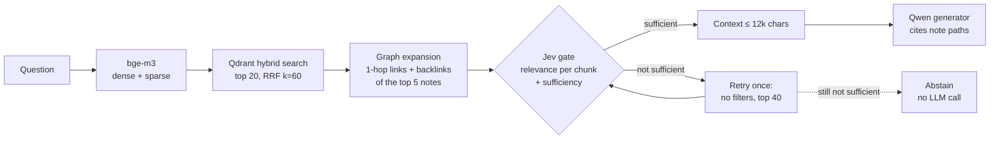
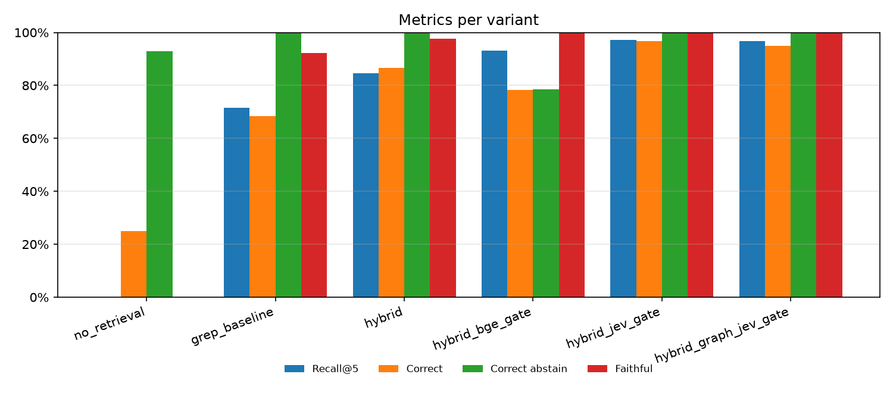
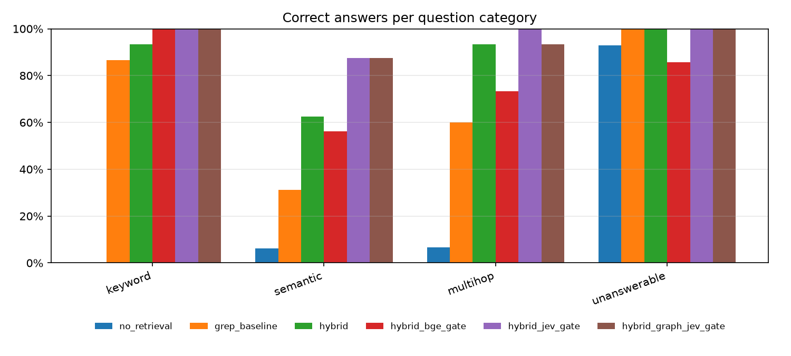
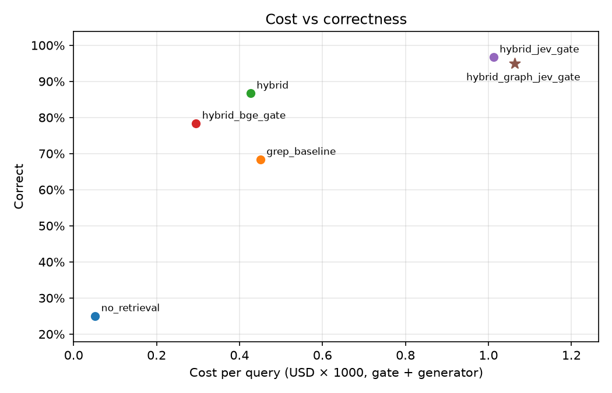

# vaultgate

Retrieval over a personal Obsidian vault that knows when the vault does not have the answer.

vaultgate combines three steps:
- **hybrid search**: bge-m3 dense and sparse vectors in Qdrant, fused with RRF;
- **one-hop expansion** through the vault's own wikilinks and backlinks, a lightweight Graph RAG;
- a **Jev gate** (TypeSafe, via OpenRouter's Decisions API) that scores every candidate chunk and decides whether the kept chunks are enough to answer. If they are not, it abstains.

It runs as an MCP tool inside Claude Code, as a FastAPI `/ask` endpoint, and as a Streamlit inspector that shows every stage.

Final project for Sertifikasi AI Super Class (LLM track). The phase plan is in [`PLAN.md`](PLAN.md).

## The problem

My vault ([PersonalBrain](https://obsidian.md)) collects notes from every Claude Code session: bugs, decisions, patterns, project logs. Until now, coding agents searched it by grepping, which has three weaknesses:
- grep misses questions asked in other words (or in Indonesian, against English notes);
- grep never follows links between notes;
- the agent answers anyway when nothing relevant comes back, and that is where hallucinations start.

vaultgate retrieves by meaning and keyword, follows the links, and refuses to answer from weak evidence.

## Architecture



| Stage | What it does | Code |
|---|---|---|
| Ingest | Parse frontmatter, headings, wikilinks and tags. Chunk per heading: short sections merge into the next one, long sections split with overlap. Re-embed only notes whose hash changed. | `src/vault_rag/ingest/` |
| Hybrid search | Dense (cosine) and sparse (lexical weights) top 20 from one Qdrant collection, fused client-side with RRF so each candidate keeps both ranks for the trace. | `retrieve/hybrid.py` |
| Graph expansion | From the 5 best notes, take linked and backlinking notes (up to 5 per seed). From each neighbor, add only its chunk closest to the query. | `graph/expand.py` |
| Gate | Jev asks one yes/no question per chunk ("does this passage help answer the query?") in byte-capped batches, then one sufficiency question over the would-be context. A bge-reranker gate and a pass-through gate share the same interface. | `gate/` |
| Retry / abstain | When the evidence is not sufficient, retry once without filters and with top 40. If that also fails, abstain without calling the LLM. | `pipeline.py` |
| Generation | Qwen answers only from the context and cites `[note/path.md]` after every claim; invented citations are flagged. | `generate.py` |
| Trace | Every candidate carries its score at every stage, plus drop reasons, retries, timings and cost. The CLI, the API, the inspector and the evaluation all read it. | `trace.py` |

### Models

| Role | Model | Where |
|---|---|---|
| Embedding (dense + sparse) | `BAAI/bge-m3` | self-hosted |
| Gate (main) | `typesafe/jev-1.14` | OpenRouter Decisions API |
| Gate (open-source fallback) | `BAAI/bge-reranker-v2-m3` + threshold | self-hosted |
| Generator | `qwen/qwen3.6-35b-a3b`, temperature 0 | OpenRouter |
| Judge (evaluation only) | `deepseek/deepseek-v4.1-flash` (not a Qwen model) | OpenRouter |

## Run it

```sh
uv sync
cp .env.example .env   # fill in OPENROUTER_API_KEY
make smoke             # Jev, OpenRouter and bge-m3 smoke tests
make test              # unit tests, no network
make index             # index data/demo-vault into local Qdrant + build the link graph
make query Q="why did the Hermes gateway mark openrouter unhealthy?"   # trace in the terminal
make serve             # API on 127.0.0.1:8000: /health, /search, /ask
make inspector         # retrieval inspector on 127.0.0.1:8501 (needs make serve)
```

**MCP (Claude Code):** register the server once. The tool forwards to the API, so `make serve` must be running.

```sh
claude mcp add vaultgate -s user -- uv --directory ~/WORK/vault-rag run python -m vault_rag.mcp_server
```

`search_vault(query, folder?, tags?)` returns either the gated passages with their note paths, or `{"status": "abstain", "reason": ...}`. The calling agent writes the answer.

**Docker:** `docker compose up -d` runs Qdrant, the API, the inspector and an hourly indexer. See [`docs/deploy.md`](docs/deploy.md).

## Retrieval inspector

`make inspector` opens one page per query. It shows:
- **Stage 1:** the hybrid candidates, with dense and sparse ranks and scores and the fused RRF score.
- **Stage 2:** the graph-added candidates, highlighted, each with the seed note and link direction that brought it in.
- **Stage 3:** the gate score of every candidate against the threshold line, with each one marked in context, kept or dropped (and why).
- **Decision:** a banner saying answer, retry or abstain, with the sufficiency score.
- **Answer:** the exact context sent to the LLM, then the cited answer.
- **Costs:** timings, tokens and cost per stage.

Compare mode runs the same query through several variants side by side. When the golden files are present, a picker loads a golden question and marks its gold notes in every table.

## Evaluation

Six systems answer the same 60 test questions with the same generator, prompt, temperature 0 and 12,000-character context budget:

| Variant | Retrieval |
|---|---|
| `no_retrieval` | none: the LLM gets the question only |
| `grep_baseline` | what a coding agent does today: grep the question's keywords, read the best-matching files whole |
| `hybrid` | dense + sparse + RRF, no gate |
| `hybrid_bge_gate` | hybrid + bge-reranker threshold gate |
| `hybrid_jev_gate` | hybrid + Jev gate |
| `hybrid_graph_jev_gate` | hybrid + graph expansion + Jev gate (the main system) |

**Golden set:** 75 questions from the demo vault (keyword, semantic, multi-hop and unanswerable). An AI drafted them; I reviewed and corrected every one. Every gold note and evidence quote was checked by `scripts/validate_golden.py`. A stratified split gives 15 dev and 60 test questions (keyword 15, semantic 16, multi-hop 15, unanswerable 14).

**Fairness:**
- Thresholds were tuned on the 15 dev questions only (`make tune`). Jev was correct on every dev decision for any sufficiency threshold from 0.2 to 0.6, so 0.5 stays. The bge threshold moved from 0.5 to 0.02.
- After tuning, the test set ran once per variant (`make eval`).
- The judge (`deepseek-v4.1-flash`) grades correctness against the reference answer and faithfulness against the context. It is not from the generator's model family.

### Results (test set, 60 questions)

| Variant | Recall@5 | MRR | Correct | Correct (answerable) | Correct abstain | False abstain | Faithful | p50 latency | Cost / query |
|---|---|---|---|---|---|---|---|---|---|
| no_retrieval | – | – | 25% | 4% | 93% | 98% | 0% | 0.9 s | $0.00005 |
| grep_baseline | 0.72 | 0.57 | 68% | 59% | 100% | 43% | 92% | 1.7 s | $0.00045 |
| hybrid | 0.85 | 0.65 | 87% | 83% | 100% | 11% | 98% | 1.8 s | $0.00043 |
| hybrid_bge_gate | 0.93 | 0.83 | 78% | 76% | 79% | 17% | 100% | 8.0 s | $0.00030 |
| **hybrid_jev_gate** | **0.97** | 0.89 | **97%** | **96%** | **100%** | **4%** | 100% | 3.2 s | $0.00101 |
| **hybrid_graph_jev_gate** | **0.97** | **0.92** | 95% | 93% | **100%** | **4%** | 100% | 3.4 s | $0.00106 |

Correct answers per category:

| Variant | keyword | semantic | multi-hop | unanswerable |
|---|---|---|---|---|
| grep_baseline | 87% | 31% | 60% | 100% |
| hybrid | 93% | 62% | 93% | 100% |
| hybrid_bge_gate | 100% | 56% | 73% | 86% |
| hybrid_jev_gate | 100% | 88% | 100% | 100% |
| hybrid_graph_jev_gate | 100% | 88% | 93% | 100% |





Recall@5 and MRR are measured on answerable questions, against the gold notes in the gate's ranking. Cost covers the gate and the generator. The whole test run cost $0.20 for the systems plus $0.10 for the judge.

### What the numbers say

- **Hybrid search beats grep by 19 points** (87% vs 68%). Most of the gain is on semantic questions (62% vs 31%). Those are Indonesian questions about English notes, where keywords do not match.
- **The Jev gate is the biggest single gain: +10 points over hybrid** (97% vs 87%), and semantic questions go from 62% to 88%. The gain comes from ranking more than from blocking. Jev re-orders the candidates by relevance (Recall@5 0.85 → 0.97), so the 12k-character context holds the right chunks instead of the first ones by RRF.
- **Abstaining.** On the 14 unanswerable questions, the Jev variants never answer. The gate itself stops 12 (no graph) or 13 (with graph) of them before any LLM call; Qwen declines the rest. The no-gate `hybrid` also declined all 14, because the strict prompt makes Qwen say "the notes do not say". So on this set the gate's abstain does not prevent hallucinations the prompt would let through. Its value is that abstaining is decided in code, costs nothing, and does not depend on the generator behaving.
- **bge as a gate is weak here.** It has no sufficiency signal, so it answered 3 unanswerable questions, and its 17% false-abstain rate is 4× Jev's. It is cheapest per query only because it sends less context.
- **Graph expansion does not change correctness on this vault** (95% vs 97% is a single question, within noise). The graph does contribute:
  - It raises MRR (0.89 → 0.92).
  - It supplied the only copy of a gold note for 2 correct answers (5%).
  - In d020 it brought in the strongest evidence of all (Jev score 0.94), from a linked pattern note.

  But this vault's project notes already summarize their linked notes, so hybrid search usually finds the answer anyway. The one loss (d042) came from extra graph chunks pushing the right chunk out of the context budget. The graph matters most when a metadata filter narrows the search; see scenario 3 in [`docs/demo.md`](docs/demo.md).
- **Cost:** the Jev gate reads every candidate, so the main system costs ~$0.001 per query (2.5× hybrid) and uses ~21k tokens, mostly Jev input. Latency stays under 6 s at p95.

Raw per-question records, CSV, charts and a 20% judge sample for manual checking are written to `eval/results/<run>/` (gitignored, because they quote the vault).

## Limitations

- **Small golden set.** The test set has 60 questions (15 to 16 per category), so a difference of one or two questions moves a rate by 6 to 7 points. Differences of a few percent are not significant.
- **Jev is a proprietary API** (and OpenRouter's Decisions endpoint is alpha). All Jev code sits in `gate/jev_gate.py` behind the same interface as the open-source bge-reranker gate, so it can be swapped out.
- **The demo vault is a sanitized subset:** 88 notes from one cluster (agent infrastructure and PKM tooling), reviewed by hand before any text went to an external API. The full vault is larger and more varied.
- **The golden set is not independent.** An AI drafted the questions from my own notes, and I reviewed and corrected them. They were validated against the notes (evidence quotes must appear verbatim). This is realistic for a personal tool, but it is not an independent benchmark.
- **The judge is an LLM.** A 20% random sample of its verdicts (65 answers) is exported to `judge_sample.md` for manual checking. Some verdicts are borderline: two of the three bge "hallucinations" partly decline.
- **The bge gate has no sufficiency signal.** It answers whenever any chunk passes its threshold, so its abstain decisions are weaker by design, not only because of the model.
